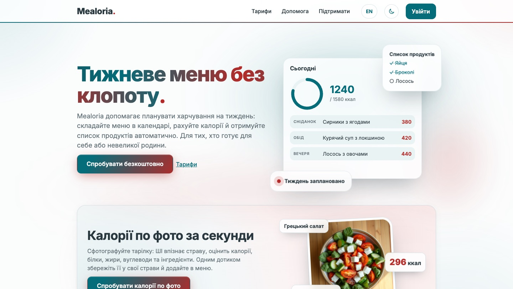
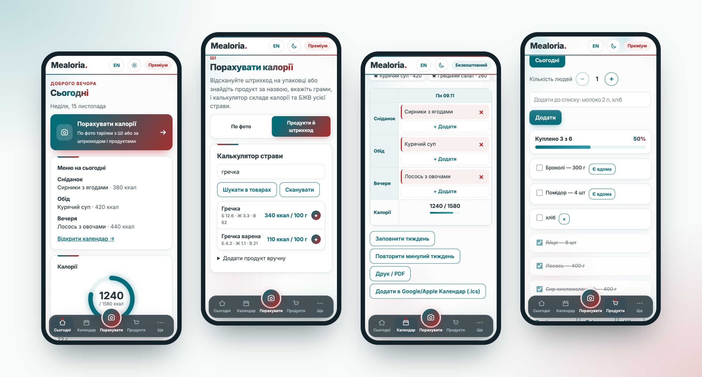
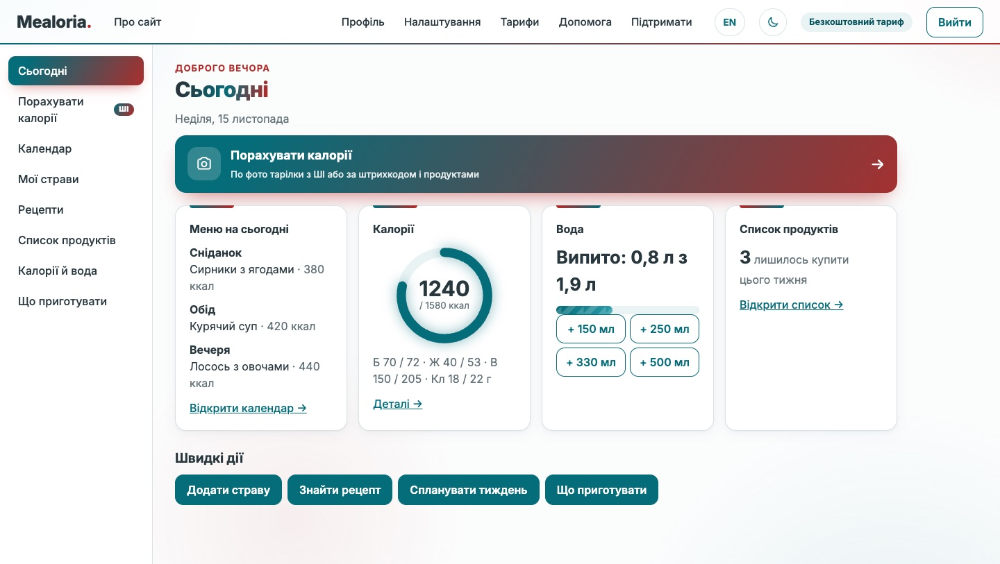
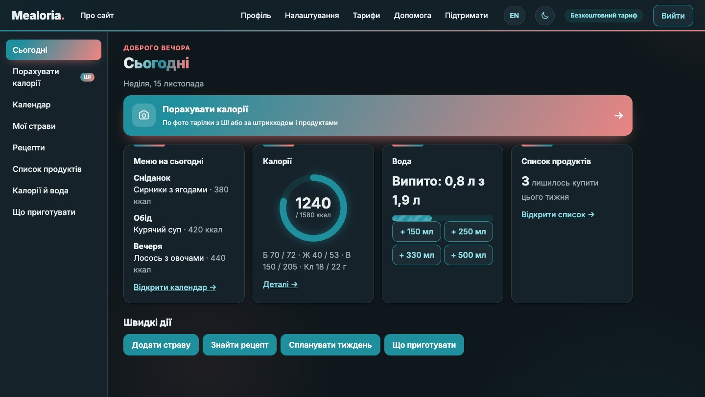
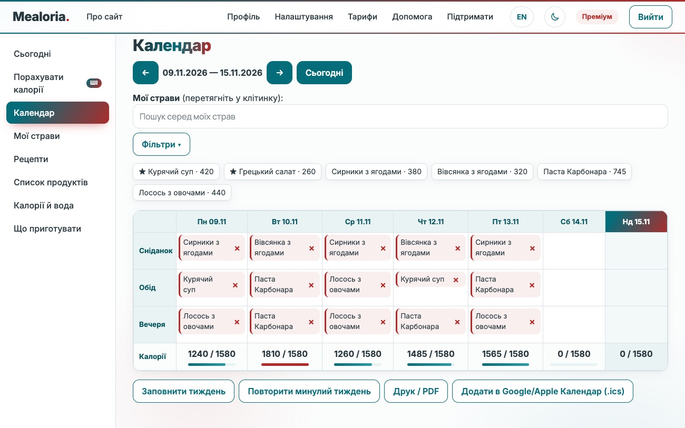
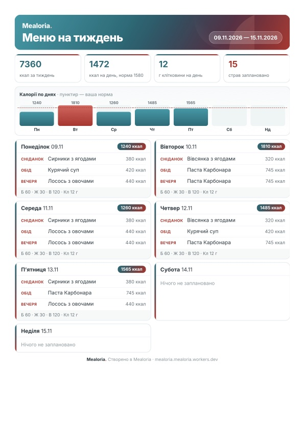
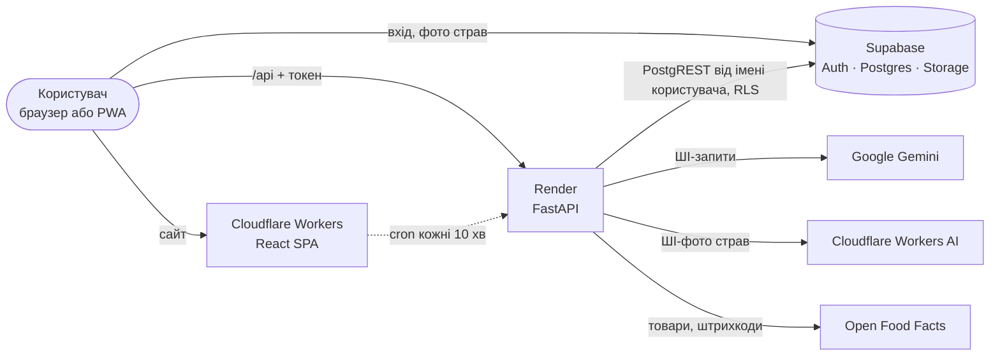

<div align="center">


# Mealoria

**Тижневе меню без клопоту.**
Плануйте страви в календарі, рахуйте калорії по фото й отримуйте список продуктів автоматично.

[**Відкрити сайт →**](https://mealoria.mealoria.workers.dev) &nbsp;·&nbsp;
[Допомога](https://mealoria.mealoria.workers.dev/help) &nbsp;·&nbsp;
[Тарифи](https://mealoria.mealoria.workers.dev/pricing)

[](https://github.com/Zavada-Sofiia/Mealoria/actions/workflows/ci.yml)


<br />



</div>

---

## Зміст

- [Що це](#що-це)
- [Можливості](#можливості)
- [Тарифи](#тарифи)
- [Скриншоти](#скриншоти)
- [Технології](#технології)
- [Архітектура](#архітектура)
- [Безпека й приватність](#безпека-й-приватність)
- [Швидкість](#швидкість)
- [Структура репозиторію](#структура-репозиторію)
- [Запуск локально](#запуск-локально)
- [Тести й CI](#тести-й-ci)
- [Деплой](#деплой)
- [Оплата переказом на картку monobank](#оплата-переказом-на-картку-monobank)
- [Дані та джерела](#дані-та-джерела)
- [Дорожня карта](#дорожня-карта)
- [Автори й ліцензія](#автори-й-ліцензія)

---

## Що це

Mealoria — вебзастосунок для тих, хто готує для себе або невеликої родини. Він знімає всю рутину з харчуванням:
складає меню на тиждень під вашу норму калорій, рахує калорії страви по фото чи за штрихкодом і сам збирає
список покупок з урахуванням того, що вже є вдома. Працює в браузері й встановлюється на телефон або комп'ютер
як звичайний застосунок.

<details>
<summary><b>English summary</b></summary>
<br />

Mealoria is a weekly meal planner for people who cook for themselves or a small family. It builds a week's menu
around your calorie goal, counts the calories of a dish from a photo (AI) or from its products and barcodes, and
assembles the shopping list automatically, minus what you already have at home. React + TypeScript on Cloudflare
Workers, FastAPI on Render, Supabase (Postgres with row-level security, Auth, Storage), Google Gemini and
Cloudflare Workers AI. The interface is available in Ukrainian and English and installs as a PWA.

</details>

---

## Можливості

<table>
<tr>
<td width="50%" valign="top">

### 📅 Планування тижня
- Календар «дні × прийоми їжі», страви перетягуються мишею й пальцем
- **«Заповнити тиждень»** підбирає страви під денний калораж і прийом їжі, не повторює страву два дні поспіль і не чіпає вже заповнене
- «Повторити минулий тиждень», пошук і фільтри страв
- Друк меню в **PDF на одну сторінку A4** з графіком калорій по днях
- Експорт `.ics` у Google чи Apple Календар

</td>
<td width="50%" valign="top">

### 📸 Порахувати калорії
- **Калорії по фото**: ШІ (Google Gemini) оцінює калорії, БЖВ та інгредієнти страви за кілька секунд
- **Калькулятор страви**: пошук під час введення серед ~1 150 продуктів українською, розуміє відмінки й описки
- **Сканер штрихкодів** (камера, бібліотека `@zxing` вантажиться лише за потреби) і фасовані товари з Open Food Facts
- Готову страву можна одразу зберегти

</td>
</tr>
<tr>
<td valign="top">

### 🥗 Страви й рецепти
- Власні страви на будь-яку кількість порцій: інгредієнти, КБЖВ, клітковина, рецепт, фото
- **Каталог із 169 рецептів** з фото, фільтрами й улюбленими
- Кількість людей перераховує інгредієнти
- Преміум: ШІ рахує КБЖВ, пише рецепт за назвою з урахуванням дієти й алергенів і малює фото страви (Cloudflare Workers AI)

</td>
<td valign="top">

### 🛒 Список продуктів
- Збирається з календаря сам, частками за порціями
- **Однакові продукти зливаються**: «яблуко» й «яблука», кілограми з грамами, літри з мілілітрами
- «Вже вдома» віднімається; швидкі кнопки для типових продуктів
- Прогрес «Куплено X з Y», надсилання в Telegram, Viber, WhatsApp

</td>
</tr>
<tr>
<td valign="top">

### 💧 Калорії, вода, вага
- Норма калорій за формулою Міффліна–Сан-Жеора, добові норми БЖВ, клітковини й води
- Кільце калорій і вода одним дотиком на екрані «Сьогодні»
- День проти норми, графіки за 7 і 30 днів, журнал ваги

</td>
<td valign="top">

### ✨ Що приготувати (ШІ)
- Рецепти під профіль і вподобання
- Рецепти з того, що є в холодильнику, з переліком, що докупити
- Відповідь мовою інтерфейсу, денний ліміт залежить від тарифу

</td>
</tr>
<tr>
<td valign="top">

### 🎨 Зручність
- Українська й англійська, світла й темна тема
- Метричні або імперські одиниці, ккал або кДж, формат дати
- Встановлення на телефон і комп'ютер (PWA), плаваюча нижня панель із камерою
- Плавні анімації, що вимикаються системним «Зменшити рух»

</td>
<td valign="top">

### 🛠 Для адміністратора
- Статистика, графіки, історія видач преміуму
- Промокоди з кількістю активацій і **власним повідомленням після активації**
- Оголошення на весь сайт (укр/англ)
- Оплати карткою з ручним підтвердженням, відгуки, тест Sentry

</td>
</tr>
</table>

---

## Тарифи

| | Безкоштовний | Преміум |
| --- | :---: | :---: |
| Власні страви | до 15 | до 500 |
| Запити до ШІ на добу | 3 | 50 |
| Планування в календарі наперед | 14 днів | рік |
| ШІ-фото власних страв на добу | — | 10 |
| ШІ сам рахує КБЖВ і пише рецепт | — | ✓ |
| Ціна | 0 грн | 49 грн/міс · 129 / 3 міс · 239 / 6 міс · 449 / рік |

Ліміти зберігає й забезпечує сама база (SQL-функція `plan_table` і тригери), тому обійти їх запитом до API
неможливо. Преміум додається оплатою на картку, промокодом або адміністратором, і кожен період **додається**
до поточного терміну, а не замінює його.

---

## Скриншоти

<div align="center">



<br /><br />

| Сьогодні | Темна тема |
| :---: | :---: |
|  |  |

| Календар на тиждень | PDF меню |
| :---: | :---: |
|  |  |

<sub>Скриншоти зроблено на демонстраційних даних.</sub>

</div>

---

## Технології

| Шар | Що використано |
| --- | --- |
| Фронтенд | React 19, TypeScript, Vite, React Router 7 (View Transitions), `@dnd-kit` для перетягування, власна i18n (ключ — український текст) |
| Бекенд | FastAPI (модульний моноліт), Pydantic, httpx, PyJWT (перевірка токена за JWKS) |
| База, вхід, файли | Supabase: Postgres з Row Level Security, Auth (пошта й пароль, Google, код підтвердження), Storage |
| ШІ | Google Gemini (рецепти, калорії по фото й КБЖВ), Cloudflare Workers AI `flux-1-schnell` (фото страв) |
| Дані про їжу | USDA FoodData Central (базова таблиця продуктів), Open Food Facts (фасовані товари й штрихкоди) |
| Хостинг | Cloudflare Workers (сайт і cron-«будильник»), Render (API), Supabase |
| Якість | pytest, Node test runner + PGlite (SQL-міграції в пам'яті), oxlint, GitHub Actions, Sentry |
| Інфраструктура кодом | Terraform (Render, налаштування авторизації Supabase, Cloudflare Worker) |

---

## Архітектура



- **Бекенд не має секретних ключів Supabase.** Він передає токен користувача в PostgREST, тож доступ до даних
  обмежують політики Row Level Security у самій базі: кожен бачить лише свої рядки.
- Бекенд перевіряє підпис токена за публічними ключами проєкту (JWKS).
- **Бізнес-правила живуть у базі:** ліміти тарифів (тригери на `dishes` і `meal_plan`), квота ШІ (`ai_quota`),
  промокоди, терміни преміуму й оплати — це SQL-функції `security definer`, які неможливо обійти запитом до API.
- Фото страв завантажуються з браузера прямо в Supabase Storage, у папку користувача.
- Пошук продуктів під час введення працює в браузері, без запитів до сервера.

---

## Безпека й приватність

- Row Level Security на всіх таблицях; адмінські функції перевіряють `public.admins` і для решти виглядають як
  неіснуючі (сторінка `/staff` показує «Не знайдено»).
- Ключі Gemini, Cloudflare й секрет оплат зберігаються лише на сервері; у браузер потрапляють тільки публічні ключі.
- Захист від підбору: обмеження на невдалі промокоди (10 на годину), відгуки (5 на добу), вхід (Supabase).
- Сайт ніколи не показує технічних подробиць помилок; людина бачить зрозумілий текст її мовою.
- Sentry не отримує пошту, cookie, заголовки (там токен входу) й тіла запитів (там фото).
- Видалення акаунта стирає всі дані й фото.
- На iPhone вхід додатково зберігається в cookie першої сторони (`Secure`, `SameSite=Strict`), бо iOS може не встигнути
  записати сховище браузера перед тим, як закрити застосунок; «Вийти» стирає й цю копію.

---

## Швидкість

- Кожна сторінка — окремий файл: стартово вантажиться ~160 КБ (gzip), решта підтягується у фоні після першого показу.
- Англійський переклад (~90 КБ), база продуктів (~95 КБ) і сканер штрихкодів вантажаться лише тоді, коли потрібні.
- Service worker тримає оболонку сайту в кеші, нова версія підтягується після кожного деплою.
- Безкоштовний Render засинає після 15 хвилин без запитів; cron у `frontend/worker/index.js` кожні 10 хвилин звертається
  до `/api/health`, тож перший відвідувач не чекає 30–60 секунд.

---

## Структура репозиторію

```
backend/                FastAPI-сервіс (модульний моноліт)
  app/
    auth.py             перевірка токена Supabase (JWT, JWKS)
    profile/            профіль і формула калоражу
    dishes/             власні страви й каталог рецептів
    calendar/           план харчування
    shopping/           список продуктів, злиття однакових продуктів, «вже вдома»
    calories/           підсумок дня, Open Food Facts, штрихкоди
    water/, weight/     вода й журнал ваги
    ai_gateway/         єдина точка виклику Gemini і Workers AI, денна квота
    limits/, promo/     тарифи, передзамовлення, промокоди
    payments/           оплата переказом на картку monobank
    admin/, notice/     сторінка розробника, оголошення на весь сайт
    feedback/, account/ відгуки, видалення акаунта
  tests/                pytest
frontend/               React + TypeScript (Vite)
  src/pages/            сторінки (кожна вантажиться окремо)
  src/components/       меню, калькулятор, камера, вода, кільце калорій…
  src/data/             таблиця продуктів USDA українською
  src/i18n/             переклади
  worker/               Cloudflare Worker: роздача сайту й cron-«будильник»
  public/               іконки, маніфест PWA, service worker, sitemap
infra/
  supabase/             SQL-міграції бази й сховища (001…037)
  tests/                тести SQL-міграцій на PGlite
  email-templates/      шаблони листів Supabase (код підтвердження, відновлення)
  scripts/              генерація фото каталогу рецептів
  terraform/            Render, Supabase Auth і Cloudflare Worker кодом
docs/images/            скриншоти для цього README
.github/workflows/      CI та «будильник» Supabase
```

---

## Запуск локально

Потрібні **Python 3.11+**, **Node.js 22+** (у CI 24) і проєкт у [Supabase](https://supabase.com).

### 1. База даних

У Supabase → **SQL Editor** по черзі виконайте файли з `infra/supabase/` — від `001` до `035`.
Скрипти можна запускати повторно. Каталог рецептів і посилання на фото лежать у `005`, `011`, `033` і `034`
(фото мають бути завантажені в Storage, див. [Дані та джерела](#дані-та-джерела)).

Вхід через Google: Authentication → Providers → Google (потрібен OAuth client із Google Cloud).
Підтвердження пошти кодом: Authentication → Sign In / Providers → Email → **Confirm email**, а шаблон листа
з `{{ .Token }}` лежить в `infra/email-templates/confirm-signup.html`.

### 2. Бекенд

```bash
cd backend
python3 -m venv .venv && source .venv/bin/activate
pip install -e ".[dev]"
cp .env.example .env        # заповніть SUPABASE_URL і SUPABASE_PUBLISHABLE_KEY
export $(grep -v '^#' .env | xargs)
uvicorn app.main:app --reload --port 8000
```

Документація API: <http://localhost:8000/docs>

| Змінна | Призначення |
| --- | --- |
| `SUPABASE_URL`, `SUPABASE_PUBLISHABLE_KEY` | адреса й публічний ключ проєкту Supabase |
| `CORS_ORIGINS` | дозволені адреси сайту через кому (необов'язково) |
| `GEMINI_API_KEY` | ключ Google AI Studio; без нього ШІ-запити повертають 503 |
| `GEMINI_MODEL`, `GEMINI_FALLBACK_MODELS` | модель (за замовчуванням `gemini-flash-lite-latest`) і резервні моделі при перевантаженні |
| `CF_ACCOUNT_ID`, `CF_API_TOKEN`, `CF_IMAGE_MODEL` | Cloudflare Workers AI для ШІ-фото страв (токен із правом Workers AI) |
| `PAYMENTS_SECRET`, `PAYMENT_CARD`, `MONOBANK_TOKEN` | оплата карткою (див. нижче) |
| `SENTRY_DSN` | звіти про помилки бекенду (необов'язково) |

### 3. Фронтенд

```bash
cd frontend
npm install
cp .env.example .env.local   # заповніть значення
npm run dev                  # http://localhost:5173
```

| Змінна | Призначення |
| --- | --- |
| `VITE_SUPABASE_URL`, `VITE_SUPABASE_PUBLISHABLE_KEY` | підключення до Supabase |
| `VITE_API_URL` | адреса бекенду, локально `http://localhost:8000` |
| `VITE_DONATION_URL` | посилання на донат (необов'язково) |
| `VITE_SENTRY_DSN` | звіти про помилки сайту (необов'язково; без неї Sentry не потрапляє в збірку) |

Усі ключі фронтенду публічні за задумом: захист даних забезпечують політики RLS, а не секретність ключів.

---

## Тести й CI

```bash
cd backend && pytest                 # 250 тестів API та бізнес-логіки
cd infra/tests && npm ci && node --test   # 40 тестів: усі SQL-міграції в Postgres у пам'яті (PGlite)
cd frontend && npm run lint && npm run build
```

`.github/workflows/ci.yml` на кожен пуш і pull request запускає тести бекенду, SQL-тести на справжніх
міграціях, лінт і збірку фронтенду, а також `terraform fmt -check` і `terraform validate`.

---

## Деплой

| Частина | Де | Налаштування |
| --- | --- | --- |
| Сайт | Cloudflare Workers | Root `frontend`, build `npm run build`, deploy `npx wrangler deploy`. `wrangler.jsonc` роздає `dist` як SPA і вмикає cron `*/10 * * * *`. Змінні `VITE_*` — **Build variables** |
| API | Render (Free) | Root `backend`, build `pip install .`, start `uvicorn app.main:app --host 0.0.0.0 --port $PORT` |
| База, вхід, фото | Supabase (Free) | SQL з `infra/supabase`; бакет `dish-photos` створює `010_photos.sql` |

Обидва сервіси розгортаються автоматично з гілки `main`. Безкоштовний Supabase зупиняє проєкт після тижня без
активності, тому `keepalive.yml` раз на 3 дні робить до нього запит. Хостинг також описано Terraform-конфігурацією
в [`infra/terraform`](infra/terraform/README.md).

---

## Оплата переказом на картку monobank

Людина обирає період на «Тарифах», отримує код замовлення `ML-XXXXXX`, переказує суму на картку й пише код
у коментарі. monobank надсилає повідомлення на `POST /api/payments/monobank/<секрет>`, бекенд знаходить код
і через SQL-функцію `confirm_card_payment` додає преміум до наявного терміну. Якщо код забули або сума менша,
замовлення лишається в адмінці для ручного підтвердження. Ціни зберігає таблиця `premium_prices`.

<details>
<summary>Налаштування</summary>
<br />

1. Виконайте `infra/supabase/029_card_payments.sql`.
2. На сторінці розробника, блок «Оплата карткою», натисніть «Створити секрет» і збережіть його.
3. У Render → Environment додайте `PAYMENTS_SECRET` і `PAYMENT_CARD` (номер картки для показу).
   Необов'язково `MONOBANK_TOKEN` з api.monobank.ua: тоді кожен платіж ще й звіряється з випискою.
4. Зареєструйте вебхук:
   `curl -X POST https://api.monobank.ua/personal/webhook -H "X-Token: <токен>" -d '{"webHookUrl":"<адреса з адмінки>"}'`

Повідомлення monobank не мають підпису, тому адреса містить секрет, а база зберігає лише його хеш.

</details>

---

## Дані та джерела

- **Продукти:** довідкові значення USDA FoodData Central (суспільне надбання), відібрані й перекладені українською
  (`frontend/src/data/usdaFoods.json`, `frontend/src/basicFoods.ts`). Фасовані товари й штрихкоди — Open Food Facts
  за ліцензією ODbL. Усі значення орієнтовні.
- **Каталог рецептів:** калорії, БЖВ і клітковина розраховані з ваги інгредієнтів.
- **Фото каталогу** згенеровано Cloudflare Workers AI скриптом `infra/scripts/recipe_photos.py`
  (потрібні `CF_ACCOUNT_ID` і `CF_API_TOKEN`), зменшено до 640 px і завантажено в Storage `dish-photos/recipes/`;
  до рецептів їх прив'язують `011_recipe_photos.sql` і `034_more_recipe_photos.sql` (виконувати **після** завантаження).

---

## Дорожня карта

- [ ] Власний домен (sitemap, CORS, адреси Supabase, шаблони листів, Search Console)
- [ ] Віджет «меню на сьогодні» на головному екрані телефона
- [ ] Щотижневий лист із підсумком харчування
- [ ] Збереження власного продукту за штрихкодом
- [ ] Анонімна аналітика використання

---

## Автори й ліцензія

**Zavada Sofiia**, **Shyrokova Anastasiia**.

Proprietary, all rights reserved. Див. [LICENSE](LICENSE).

<div align="center">
<br />

<br />
<sub>Зроблено з турботою про тих, хто готує вдома.</sub>
</div>
