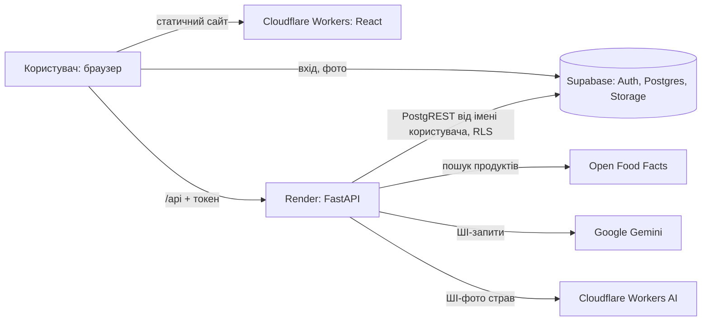

# Mealoria

Вебзастосунок для планування харчування на тиждень: для тих, хто готує для себе або невеликої родини.
Календар зі стравами, власні страви й каталог рецептів, калорії та автоматичний список продуктів.

Автори: Zavada Sofiia, Shyrokova Anastasiia.

## Можливості

| Розділ | Що вміє |
| --- | --- |
| Про сайт, Тарифи, Підтримати | Публічні сторінки (на головній є інструкція, як встановити сайт як застосунок на iPhone, Android і комп’ютер, і кнопка «Встановити», де браузер це дозволяє). На «Тарифах» кнопка передзамовлення преміуму (оплати немає, лише облік попиту) |
| Вхід | Email і пароль або Google (Supabase Auth). Пароль при реєстрації перевіряється (довжина, літери й цифри, поширені паролі, послідовності), є скидання пароля листом |
| Профіль | Ім’я та прізвище, вік, зріст, вага, мета, активність, кількість прийомів їжі, калораж за формулою Міффліна–Сан-Жеора, опитувальник вподобань (дієта, алергени, кухні, час, бюджет) |
| Сьогодні | Меню на сьогодні, калорії проти цілі, скільки лишилось купити |
| Календар | Тиждень «дні × прийоми їжі», страви перетягуються мишею й пальцем, калорії за день. На телефоні показано один день зі смужкою днів і кнопкою «+ Додати». Є «Повторити минулий тиждень», друк у PDF і експорт `.ics` для Google/Apple Календаря |
| Мої страви | Окрема сторінка зі списком страв (пошук, сортування, лише улюблені, фільтр за категорією: сніданок, обід, вечеря, перекус, основна страва, суп, салат, гарнір, закуска, десерт, випічка, напій; у календарі підхожі страви стоять першими), форма відкривається кнопкою. Власні страви на задану кількість порцій (каструля): інгредієнти на всю страву, калорії й БЖВ на порцію, кожен запис у календарі це одна порція, список продуктів бере 1/порцій інгредієнтів. Інгредієнти, калоріями, БЖВ, рецептом і фото. У преміумі ШІ сам рахує калорії й БЖВ (Gemini), якщо їх не вказано, і може намалювати фото страви (Cloudflare Workers AI) з попереднім переглядом, а також написати рецепт та інгредієнти за назвою з урахуванням дієти й алергенів з профілю |
| Рецепти | Каталог із 29 рецептів, кількість людей множить інгредієнти (так само у списку продуктів), пошук, фільтр за вподобаннями з профілю, кнопки «У мої страви» і «В календар» |
| Список продуктів | Збирається з календаря, а також можна додати продукт вручну без календаря (зберігається в усіх тижнях, «Прибрати куплені»): однакові інгредієнти сумуються, продукти «вже вдома» віднімаються (кнопка «Є вдома» біля продукту, швидкі кнопки для типових продуктів, кілька через кому), куплене можна відзначати |
| Калорії | Вкладки з рухомим індикатором для переходу між блоками сторінки. Підсумок дня (калорії, БЖВ і клітковина) з порівнянням до цілі, графік калорій за 7 і 30 днів, журнал ваги з графіком, оцінка калорій по фото страви (ШІ) і калькулятор страви за базою Open Food Facts |
| Мови | Інтерфейс українською й англійською, перемикач «UA/EN» у шапці. Мова за замовчуванням береться з браузера, вибір запам'ятовується. ШІ відповідає мовою інтерфейсу (заголовок `X-Lang`). Переклади лежать в `frontend/src/i18n/en.ts` (ключ — український текст). Каталог рецептів, пошук продуктів і сторінка для розробників поки лише українською |
| Акаунт | Видалення акаунта з усіма даними й фото (Профіль), сторінки «Умови» та «Конфіденційність», темна тема, установка на телефон (PWA), улюблені страви |
| Статистика для розробників | Прихована сторінка (реєстрації, передзамовлення, активність). Дані віддає SQL-функція `admin_stats` лише користувачам зі списку `public.admins`, для всіх інших сторінка виглядає як неіснуюча |
| ШІ-помічник | Підбір рецептів під профіль, окремо рецепти з того, що є в холодильнику, вкладки з рухомим індикатором під шапкою для швидкого переходу між блоками (список продуктів або «Вже є вдома», режим «лише з цих продуктів», у відповіді є що докупити) (Google Gemini), денний ліміт запитів залежить від тарифу |
| Тарифи | Безкоштовний (до 15 страв, 3 запити до ШІ на добу, планування на 14 днів уперед) і преміум (до 500 страв, 50 запитів, планування на рік, 10 ШІ-фото страв на добу). Числа задає SQL-функція `plan_table`; ліміти страв і горизонту планування забезпечують тригери бази, тому їх неможливо обійти. Преміум поки видає адміністратор зі сторінки статистики, оплати немає |

Не реалізовано (заплановано): віджет, реальна оплата. Каталог `backend/app/donations` поки порожній.

## Структура репозиторію

```
backend/            FastAPI-сервіс (модульний моноліт)
  app/
    auth.py         перевірка токена Supabase (JWT)
    profile/        профіль і формула калоражу
    dishes/         свої страви та каталог рецептів
    calendar/       план харчування
    shopping/       список продуктів, «вже вдома»
    calories/       підсумок дня, пошук продуктів
    limits/         передзамовлення преміуму
    admin/          статистика для розробників (доступ за таблицею admins)
    ai_gateway/     єдина точка виклику Gemini, денна квота, підбір рецептів і калорії по фото
  tests/            pytest
frontend/           React + TypeScript (Vite)
  src/pages/        сторінки
  src/components/   меню
  src/api/          клієнт API, Supabase, завантаження фото
infra/
  supabase/         SQL-скрипти бази й сховища (001…024)
  scripts/          генерація фото для каталогу рецептів
  terraform/        опис Render, Supabase (авторизація) і Cloudflare Worker кодом
.github/workflows/  CI (тести й збірка) та «будильник» Supabase
```

## Архітектура



- Бекенд не має секретних ключів Supabase: він передає токен користувача в PostgREST, тож доступ до даних
  обмежують політики **Row Level Security** у самій базі. Кожен користувач бачить лише свої рядки.
- Бекенд перевіряє підпис токена за публічними ключами проєкту (JWKS).
- Ліміти тарифів живуть у базі: тригери на `dishes` і `meal_plan` відмовляють у запису понад ліміт, навіть якщо звертатися до API напряму. Ліміт ШІ-запитів рахує SQL-функція `ai_quota` (таблицю `ai_usage` користувач бачить, але змінити напряму не може), тож обійти квоту неможливо. Ключ Gemini зберігається лише на сервері.
- Фото страв завантажуються з браузера прямо в Supabase Storage, у папку користувача.

## Запуск локально

Потрібні Python 3.11+, Node.js 22+ (у CI використовується 24) і проєкт у [Supabase](https://supabase.com).

### 1. База даних

У Supabase → SQL Editor по черзі виконайте файли з `infra/supabase/` (від `001` до `024`).
Скрипти можна запускати повторно. Файли `005` і `011` містять каталог рецептів і посилання на їхні фото.
Для `011` фото мають бути завантажені в Storage (див. нижче).

Вхід через Google: Authentication → Providers → Google, потрібен OAuth client із Google Cloud.

### 2. Бекенд

```bash
cd backend
python3 -m venv .venv && source .venv/bin/activate
pip install -e ".[dev]"
cp .env.example .env        # заповніть SUPABASE_URL і SUPABASE_PUBLISHABLE_KEY
export $(grep -v '^#' .env | xargs)
uvicorn app.main:app --reload --port 8000
pytest                      # тести
```

Документація API: http://localhost:8000/docs

| Змінна | Призначення |
| --- | --- |
| `SUPABASE_URL` | адреса проєкту, `https://xxxx.supabase.co` |
| `SUPABASE_PUBLISHABLE_KEY` | публічний ключ (publishable) |
| `CORS_ORIGINS` | дозволені адреси сайту через кому (необов'язково) |
| `CF_ACCOUNT_ID`, `CF_API_TOKEN` | Cloudflare Workers AI для ШІ-фото страв (преміум). Токен із правом Workers AI. Без них генерація фото повертає 503 |
| `CF_IMAGE_MODEL` | модель зображень, за замовчуванням `@cf/black-forest-labs/flux-1-schnell` (необов'язково) |
| `SENTRY_DSN` | адреса Sentry для звітів про помилки бекенду (необов'язково; без неї моніторинг вимкнений) |
| `GEMINI_API_KEY` | ключ Google AI Studio для ШІ-помічника. Без нього ШІ-запити повертають 503 |
| `GEMINI_MODEL` | модель Gemini, за замовчуванням `gemini-flash-lite-latest` (швидка Flash-Lite, завжди актуальна) |
| `GEMINI_FALLBACK_MODELS` | резервні моделі через кому, на які бекенд переходить при перевантаженні чи таймауті (необов'язково) |

### 3. Фронтенд

```bash
cd frontend
npm install
cp .env.example .env.local   # заповніть значення
npm run dev                  # http://localhost:5173
npm run lint
npm run build
```

| Змінна | Призначення |
| --- | --- |
| `VITE_SUPABASE_URL`, `VITE_SUPABASE_PUBLISHABLE_KEY` | підключення до Supabase |
| `VITE_API_URL` | адреса бекенду, локально `http://localhost:8000` |
| `VITE_DONATION_URL` | посилання на донат (необов'язково) |
| `VITE_SENTRY_DSN` | адреса Sentry для звітів про помилки сайту (необов'язково; без неї моніторинг вимкнений і не потрапляє в збірку) |

Усі ключі тут публічні за задумом: захист даних забезпечують політики RLS, а не секретність ключів.
Секретні ключі (service role, токени Cloudflare) у репозиторій не потрапляють.

## Деплой

| Частина | Де | Налаштування |
| --- | --- | --- |
| Фронтенд | Cloudflare Workers (статичні файли) | Root directory `frontend`, build `npm run build`, deploy `npx wrangler deploy`. Змінні `VITE_*` задаються як **Build variables**. SPA-маршрути обробляє `frontend/wrangler.jsonc` |
| Бекенд | Render, Free | Root directory `backend`, build `pip install .`, start `uvicorn app.main:app --host 0.0.0.0 --port $PORT`, змінні `SUPABASE_URL` і `SUPABASE_PUBLISHABLE_KEY` |
| База, вхід, фото | Supabase, Free | SQL із `infra/supabase`, Storage-бакет `dish-photos` створює `010_photos.sql` |

Обидва сервіси розгортаються автоматично з гілки `main`. Безкоштовний Render засинає через 15 хвилин
без запитів (перший запит триває близько хвилини). Безкоштовний Supabase зупиняє проєкт після тижня без
активності, тому workflow `keepalive.yml` раз на 3 дні робить до нього запит.

## Моніторинг помилок

Sentry вмикається змінними `SENTRY_DSN` (бекенд) і `VITE_SENTRY_DSN` (сайт); без них нічого не відбувається.
Не надсилаються cookie, заголовки (там токен входу), тіла запитів (там фото) і дані користувача.
Очікувані відповіді (ліміти тарифу, «ШІ зайнятий», 401/403/404) помилками не вважаються. Перевірити
підключення можна кнопкою «Надіслати тестову помилку» на сторінці `/staff`.

## Інфраструктура кодом

Хостинг описано Terraform-конфігурацією в `infra/terraform` (Render, налаштування авторизації Supabase,
Cloudflare Worker). Інструкція з перевірки та імпорту наявних сервісів: [infra/terraform/README.md](infra/terraform/README.md).

## CI

`.github/workflows/ci.yml` на кожен пуш і pull request запускає:

- бекенд: `pip install` і `pytest`;
- фронтенд: `npm ci`, `npm run lint`, `npm run build`;
- інфраструктура: `terraform fmt -check` і `terraform validate`.

## Фото каталогу рецептів

Фото згенеровано через Cloudflare Workers AI скриптом `infra/scripts/recipe_photos.py` (потрібні
`CF_ACCOUNT_ID` і `CF_API_TOKEN`, див. коментар на початку файлу). Результат зменшують до 640 px і
завантажують у Storage: `dish-photos/recipes/`. Після цього `infra/supabase/011_recipe_photos.sql`
прив'язує їх до рецептів.

## Заплановано

- Фото до власної страви від ШІ, преміум-тариф із більшим лімітом ШІ.
- Реальна оплата преміуму після перевірки попиту.

## Ліцензія

Proprietary, all rights reserved. Див. [LICENSE](LICENSE).
