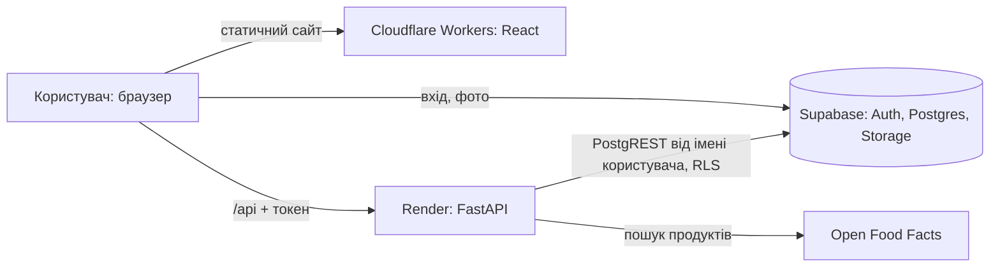

# Mealoria

Вебзастосунок для планування харчування на тиждень: для тих, хто готує для себе або невеликої родини.
Календар зі стравами, власні страви й каталог рецептів, калорії та автоматичний список продуктів.

Автори: Zavada Sofiia, Shyrokova Anastasiia.

## Можливості

| Розділ | Що вміє |
| --- | --- |
| Про сайт, Тарифи, Підтримати | Публічні сторінки. На «Тарифах» кнопка передзамовлення преміуму (оплати немає, лише облік попиту) |
| Вхід | Email і пароль або Google (Supabase Auth) |
| Профіль | Вік, зріст, вага, мета, активність, кількість прийомів їжі, калораж за формулою Міффліна–Сан-Жеора, опитувальник вподобань (дієта, алергени, кухні, час, бюджет) |
| Сьогодні | Меню на сьогодні, калорії проти цілі, скільки лишилось купити |
| Календар | Тиждень «дні × прийоми їжі», страви перетягуються мишею й пальцем, калорії за день |
| Мої страви | Власні страви з інгредієнтами, калоріями, БЖВ, рецептом і фото |
| Рецепти | Каталог із 29 рецептів, пошук, фільтр за вподобаннями з профілю, кнопки «У мої страви» і «В календар» |
| Список продуктів | Збирається з календаря: однакові інгредієнти сумуються, продукти «вже вдома» віднімаються, куплене можна відзначати |
| Калорії | Підсумок дня з порівнянням до цілі й калькулятор страви за базою Open Food Facts |

Не реалізовано (заплановано): функції на ШІ (калорії по фото, підбір рецептів, фото до страв), віджет, реальна оплата.
Каталоги `backend/app/ai_gateway` і `backend/app/donations` поки порожні.

## Структура репозиторію

```
backend/            FastAPI-сервіс (модульний моноліт)
  app/
    auth.py         перевірка токена Supabase (JWT)
    profile/        профіль і формула калоражу
    dishes/         свої страви та каталог рецептів
    calendar/       план харчування
    shopping/       список продуктів, «вже вдома»
    calories/       підсумок дня, пошук продуктів
    limits/         передзамовлення преміуму
  tests/            pytest
frontend/           React + TypeScript (Vite)
  src/pages/        сторінки
  src/components/   меню
  src/api/          клієнт API, Supabase, завантаження фото
infra/
  supabase/         SQL-скрипти бази й сховища (001…011)
  scripts/          генерація фото для каталогу рецептів
.github/workflows/  CI (тести й збірка) та «будильник» Supabase
```

## Архітектура



- Бекенд не має секретних ключів Supabase: він передає токен користувача в PostgREST, тож доступ до даних
  обмежують політики **Row Level Security** у самій базі. Кожен користувач бачить лише свої рядки.
- Бекенд перевіряє підпис токена за публічними ключами проєкту (JWKS).
- Фото страв завантажуються з браузера прямо в Supabase Storage, у папку користувача.

## Запуск локально

Потрібні Python 3.11+, Node.js 22+ (у CI використовується 24) і проєкт у [Supabase](https://supabase.com).

### 1. База даних

У Supabase → SQL Editor по черзі виконайте файли з `infra/supabase/` (від `001` до `011`).
Скрипти можна запускати повторно. Файли `005` і `011` містять каталог рецептів і посилання на їхні фото.
Для `011` фото мають бути завантажені в Storage (див. нижче).

Вхід через Google: Authentication → Providers → Google, потрібен OAuth client із Google Cloud.

### 2. Бекенд

```bash
cd backend
python3 -m venv .venv && source .venv/bin/activate
pip install -e ".[dev]"
cp .env.example .env        # заповніть SUPABASE_URL і SUPABASE_PUBLISHABLE_KEY
export $(grep -v '^#' .env | xargs)
uvicorn app.main:app --reload --port 8000
pytest                      # тести
```

Документація API: http://localhost:8000/docs

| Змінна | Призначення |
| --- | --- |
| `SUPABASE_URL` | адреса проєкту, `https://xxxx.supabase.co` |
| `SUPABASE_PUBLISHABLE_KEY` | публічний ключ (publishable) |
| `CORS_ORIGINS` | дозволені адреси сайту через кому (необов'язково) |

### 3. Фронтенд

```bash
cd frontend
npm install
cp .env.example .env.local   # заповніть значення
npm run dev                  # http://localhost:5173
npm run lint
npm run build
```

| Змінна | Призначення |
| --- | --- |
| `VITE_SUPABASE_URL`, `VITE_SUPABASE_PUBLISHABLE_KEY` | підключення до Supabase |
| `VITE_API_URL` | адреса бекенду, локально `http://localhost:8000` |
| `VITE_DONATION_URL` | посилання на донат (необов'язково) |

Усі ключі тут публічні за задумом: захист даних забезпечують політики RLS, а не секретність ключів.
Секретні ключі (service role, токени Cloudflare) у репозиторій не потрапляють.

## Деплой

| Частина | Де | Налаштування |
| --- | --- | --- |
| Фронтенд | Cloudflare Workers (статичні файли) | Root directory `frontend`, build `npm run build`, deploy `npx wrangler deploy`. Змінні `VITE_*` задаються як **Build variables**. SPA-маршрути обробляє `frontend/wrangler.jsonc` |
| Бекенд | Render, Free | Root directory `backend`, build `pip install .`, start `uvicorn app.main:app --host 0.0.0.0 --port $PORT`, змінні `SUPABASE_URL` і `SUPABASE_PUBLISHABLE_KEY` |
| База, вхід, фото | Supabase, Free | SQL із `infra/supabase`, Storage-бакет `dish-photos` створює `010_photos.sql` |

Обидва сервіси розгортаються автоматично з гілки `main`. Безкоштовний Render засинає через 15 хвилин
без запитів (перший запит триває близько хвилини). Безкоштовний Supabase зупиняє проєкт після тижня без
активності, тому workflow `keepalive.yml` раз на 3 дні робить до нього запит.

## CI

`.github/workflows/ci.yml` на кожен пуш і pull request запускає:

- бекенд: `pip install` і `pytest`;
- фронтенд: `npm ci`, `npm run lint`, `npm run build`.

## Фото каталогу рецептів

Фото згенеровано через Cloudflare Workers AI скриптом `infra/scripts/recipe_photos.py` (потрібні
`CF_ACCOUNT_ID` і `CF_API_TOKEN`, див. коментар на початку файлу). Результат зменшують до 640 px і
завантажують у Storage: `dish-photos/recipes/`. Після цього `infra/supabase/011_recipe_photos.sql`
прив'язує їх до рецептів.

## Заплановано

- Опис інфраструктури кодом (Terraform) у `infra/`.
- Відстеження помилок (Sentry).
- Функції на ШІ (Gemini, Workers AI) з квотами на користувача.
- Реальна оплата преміуму після перевірки попиту.

## Ліцензія

Proprietary, all rights reserved. Див. [LICENSE](LICENSE).
